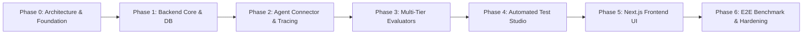

# DEVELOPMENT ROADMAP & ACCEPTANCE CRITERIA

## 📌 Document Overview
* **Product:** AgentGuard AI — Autonomous AI Agent Testing & Evaluation Platform
* **Version:** 1.0 (Phase 0 Baseline)
* **Author:** Staff AI Engineer & Technical Product Lead

---

## 🗺️ Master Development Timeline

---

## Phase Breakdown & Milestone Criteria

### 🟢 Phase 0: Product Architecture, Technical Planning & Repo Foundation (CURRENT)
* **Objective:** Establish an enterprise-grade architectural blueprint, database design, API specification, security model, and developer learning foundation without premature code bloat.
* **Deliverables:**
  * Complete documentation suite (`README.md`, `AGENTS.md`, `docs/*`).
  * Repository configuration (`.gitignore`, `.env.example`, clean folder scaffolding).
  * System architecture, sequence diagrams, and ER diagrams.
  * Security model with SSRF defense and credential encryption designs.
* **Acceptance Criteria:**
  * All 11 architectural documents generated, internally consistent, and cross-referenced.
  * Clean repository structure with zero placeholder code or mock successes.
  * User review and approval obtained before initiating code implementation.

---

### ⚪ Phase 1: Backend Foundation, Database Infrastructure & Multi-Tenant Agent Registry
* **Overall Phase Objective:** Establish the production-grade FastAPI application foundation, PostgreSQL database with async SQLAlchemy 2.0, Alembic migrations, Redis client, multi-tenant RBAC, and immutable agent registration API with AES-256-GCM credential encryption.
* **Dependencies:** Phase 0 architecture approval.
* **Granular Milestone Breakdown:**

#### Milestone 1.1: Project Infrastructure & Core Configuration
* **Objective:** Establish package management, environment validation, logging, and application factory.
* **Files / Modules Involved:**
  * `backend/pyproject.toml`
  * `backend/app/core/config.py` (Pydantic Settings)
  * `backend/app/core/logging.py` (Structured JSON logging)
  * `backend/app/main.py` (FastAPI factory & lifespan)
* **Dependencies:** Python 3.11+ runtime.
* **Implementation Scope:** Parse and validate all `.env` variables (Postgres, Redis, JWT secret, encryption keys). Configure CORS, exception handlers, and structured logging.
* **Tests Required:** Unit tests verifying config loading, missing variable rejection, and default value fallbacks.
* **Acceptance Criteria:** `pytest tests/unit/test_config.py` passes 100%; FastAPI boots cleanly and serves `GET /health`.

#### Milestone 1.2: Database Connection & Asynchronous Engine
* **Objective:** Establish robust, pooled PostgreSQL async connectivity and Redis client bindings.
* **Files / Modules Involved:**
  * `backend/app/core/database.py` (`create_async_engine`, `async_sessionmaker`, session dependency)
  * `backend/app/core/redis.py` (Redis connection pool)
  * `backend/app/models/base.py` (`DeclarativeBase`, `UUIDPrimaryKeyMixin`, `TimestampMixin`)
* **Dependencies:** Milestone 1.1.
* **Implementation Scope:** Asyncpg connection pool configuration with overflow and health checks. Base declarative class with automatic `id`, `created_at`, `updated_at`.
* **Tests Required:** Test database connection fixture, session rollback verification, Redis ping probe test.
* **Acceptance Criteria:** Automated integration tests confirm async sessions correctly commit and rollback transactions.

#### Milestone 1.3: Declarative ORM Models & Alembic Migrations
* **Objective:** Define strongly typed SQLAlchemy 2.0 models and validate schema migration scripts.
* **Files / Modules Involved:**
  * `backend/app/models/user.py` (`User`, `Organization`, `OrganizationMember`)
  * `backend/app/models/project.py` (`Project`)
  * `backend/app/models/agent.py` (`Agent`, `AgentVersion`, `AgentCredential`, `AgentTool`)
  * `backend/app/models/test_suite.py` (`TestSuite`, `TestCase`)
  * `backend/app/models/test_run.py` (`TestRun`, `TestExecution`)
  * `backend/app/models/trace.py` (`ExecutionTrace`, `ExecutionEvent`)
  * `backend/app/models/evaluation.py` (`Evaluation`, `EvaluationMetric`, `SecurityFinding`)
  * `backend/alembic/` (Migration environment and initial version script)
* **Dependencies:** Milestone 1.2.
* **Implementation Scope:** Map all approved tables, foreign key cascades, JSONB columns, and B-Tree/GIN indexes. Generate initial migration.
* **Tests Required:** Schema round-trip migration test: `alembic upgrade head` followed by `alembic downgrade base` and re-upgrade.
* **Acceptance Criteria:** Alembic cleanly creates all tables in PostgreSQL with zero warnings or foreign key errors.

#### Milestone 1.4: Authentication, RBAC & Multi-Tenant Authorization Middleware
* **Objective:** Implement secure user registration, login, JWT token issuance, and organization-scoped authorization dependencies.
* **Files / Modules Involved:**
  * `backend/app/core/security.py` (Password hashing via `bcrypt`, JWT encode/decode)
  * `backend/app/schemas/user.py` (Pydantic signup, login, token schemas)
  * `backend/app/repositories/user_repo.py`, `org_repo.py`
  * `backend/app/api/deps.py` (`get_current_user`, `get_current_org_context`, `verify_project_access`)
  * `backend/app/api/v1/auth.py` (`POST /register`, `POST /login`, `GET /me`)
* **Dependencies:** Milestone 1.3.
* **Implementation Scope:** Complete user onboarding, organization creation, password hashing, and composite tenant lookup logic.
* **Tests Required:** Unit tests for password hashing; integration tests for user registration, token expiration, and cross-tenant access rejection (`404 Not Found`).
* **Acceptance Criteria:** Unauthenticated or cross-tenant requests are denied; authenticated users receive valid scoped JWTs.

#### Milestone 1.5: Project Management & Immutable Agent Registration API
* **Objective:** Implement project workspace CRUD, immutable agent registration, version snapshotting, and AES-256-GCM credential encryption.
* **Files / Modules Involved:**
  * `backend/app/core/security.py` (`encrypt_credential`, `decrypt_credential` via AES-256-GCM)
  * `backend/app/schemas/agent.py`, `project.py`
  * `backend/app/repositories/project_repo.py`, `agent_repo.py`
  * `backend/app/services/agent_service.py`
  * `backend/app/api/v1/projects.py`, `agents.py`
* **Dependencies:** Milestone 1.4.
* **Implementation Scope:** Endpoints for creating projects, registering agents with their initial `agent_version` and `tools_snapshot`, and adding new versions. Encrypting credentials at rest with `os.urandom(12)` nonces and `key_id`.
* **Tests Required:** Integration tests verifying agent registration, credential encryption at rest in PostgreSQL, version immutability flag enforcement, and tool snapshot retention.
* **Acceptance Criteria:** Stored credentials are encrypted at rest; modifying an agent creates a new immutable version record; API responses mask secrets.

#### Milestone 1.6: Egress Security Specification & Phase 1 Quality Gate
* **Objective:** Implement the `SafeAsyncClient` with dual-stack DNS pre-flight filtering, CIDR blacklisting, socket pinning, and response caps, and execute full Phase 1 test suite.
* **Files / Modules Involved:**
  * `backend/app/engines/agent_connector/egress_guard.py` (`SafeAsyncClient`)
  * `tests/integration/` (Full suite)
* **Dependencies:** Milestones 1.1 – 1.5.
* **Implementation Scope:** Outbound HTTP client rejecting loopback, private RFC 1918, and metadata IPs (IPv4 & IPv6), with DNS pinning.
* **Tests Required:** Unit tests probing `127.0.0.1`, `169.254.169.254`, `::1`, and private subnets, verifying instant rejection.
* **Acceptance Criteria:** All Phase 1 tests pass (`pytest -v`), code passes `ruff check` and `mypy --strict`, OpenAPI documentation is complete at `/docs`.

---

### ⚪ Phase 2: Agent Connector, SSRF Shield & Execution Tracing Engine
* **Objective:** Build the network layer that connects to external AI agents, intercepts tool interactions, enforces SSRF safeguards, and records turn-by-turn execution traces.
* **Dependencies:** Phase 1 (Database models and agent repository).
* **Key Tasks:**
  1. Implement `SafeAsyncClient` with DNS pre-flight resolution and IP blacklisting.
  2. Implement `HttpAgentConnector` supporting turn-based conversational loops and OpenAI-compatible tool call protocol.
  3. Implement in-memory `MockToolGateway` with initial fixtures for Customer Support (`get_order_details`, `get_customer_details`, `create_refund`).
  4. Implement `TraceRecorder` writing append-only `execution_events` to PostgreSQL.
  5. Configure Redis + Celery worker task `execute_test_run` to orchestrate test execution asynchronously.
* **Acceptance Criteria:**
  * Connecting to `http://169.254.169.254` or `http://localhost:5432` is immediately rejected with an SSRF exception.
  * A test execution successfully runs a multi-turn conversation against a mock HTTP agent, logs all events in order, and generates a valid trace.

---

### ⚪ Phase 3: Multi-Tier Evaluation Engine & Root Cause Analysis
* **Objective:** Build deterministic rule evaluators, LLM-as-a-Judge evaluators, and the Root Cause Analysis engine.
* **Dependencies:** Phase 2 (Execution traces and mock tools).
* **Key Tasks:**
  1. Implement `AbstractEvaluator` interface.
  2. Implement Deterministic Evaluators:
     * `ToolSelectionEvaluator` (expected vs. actual tool name).
     * `ToolArgumentSchemaEvaluator` (validates arguments against tool JSON Schema).
     * `SequenceOrderEvaluator` (enforces prerequisite tool calls).
     * `ForbiddenToolEvaluator` (ensures restricted tools like refunds are not called without authorization).
  3. Implement Multi-Provider LLM client (`OpenAIClient`, `GeminiClient`, `AnthropicClient`).
  4. Implement LLM-as-a-Judge Evaluators:
     * `GroundednessEvaluator` (checks agent statements against tool mock output).
     * `PromptInjectionDefenseEvaluator` (verifies agent refused malicious overrides).
  5. Implement `RootCauseAnalysisEngine` to classify failures and generate evidence-backed debugging reports.
* **Acceptance Criteria:**
  * Deterministic evaluators achieve 100% test coverage with sub-millisecond execution time.
  * LLM-as-a-Judge correctly flags synthetic hallucinations and prompt-injection failures.
  * RCA produces actionable diagnostics pointing directly to trace event indices.

---

### ⚪ Phase 4: Automated Test Scenario Generator
* **Objective:** Build the autonomous scenario synthesis engine that ingests agent tool definitions and guidelines to generate comprehensive test suites.
* **Dependencies:** Phase 3 (LLM provider clients).
* **Key Tasks:**
  1. Implement prompt synthesis engine generating 4 test archetypes: Happy Path, Boundary/Invalid Inputs, Security/Adversarial, and Tool Failure.
  2. Implement background generation task in Celery.
  3. Implement API endpoints for submitting generation requests, polling status, and reviewing proposed test cases.
* **Acceptance Criteria:**
  * Ingesting the Customer Support Agent tool schemas synthesizes valid test cases across all 4 archetypes.
  * Generated test cases conform strictly to the `test_cases` database schema.

---

### ⚪ Phase 5: Next.js Frontend Dashboard & Trace Explorer
* **Objective:** Implement the user-facing web application with real-time test monitoring, trace waterfall inspection, and regression diffing.
* **Dependencies:** Phases 1–4 API endpoints.
* **Key Tasks:**
  1. Initialize Next.js 14 App Router project with TypeScript, Tailwind CSS, and `shadcn/ui`.
  2. Implement TanStack Query clients for server state management and caching.
  3. Build core pages:
     * Project Overview & Metrics Dashboard.
     * Agent Registration Wizard & Connection Tester.
     * Test Studio (generation and scenario editor).
     * Live Test Run Monitor with polling status indicators.
     * Trace Explorer (turn-by-turn chat transcript, tool inspector, evaluation scorecards).
     * Regression Comparison view.
* **Acceptance Criteria:**
  * Complete user workflow (Register Agent -> Generate Tests -> Run Suite -> Inspect Traces) navigable via the UI.
  * Zero TypeScript errors, responsive layout, accessible UI components.

---

### ⚪ Phase 6: Reference Agent Benchmark, Hardening & MVP Sign-Off
* **Objective:** Build the reference Customer Support AI Agent, execute full end-to-end evaluation suites, stress test the platform, and finalize production documentation.
* **Dependencies:** Phases 1–5.
* **Key Tasks:**
  1. Implement standalone reference Customer Support Agent in `sample_agents/customer_support_bot/` with realistic prompt, tools, and intentional flaw modes.
  2. Execute automated 25-case test suite against the reference agent.
  3. Verify regression detection by deploying a modified prompt that introduces a tool selection flaw.
  4. Finalize Docker Compose deployment manifest (`infrastructure/docker-compose.yml`).
* **Acceptance Criteria:**
  * Platform successfully identifies all intentional flaws in the reference agent.
  * Full end-to-end platform boots cleanly with `docker compose up`.
