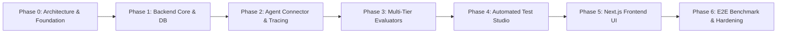

# DEVELOPMENT ROADMAP & ACCEPTANCE CRITERIA

## 📌 Document Overview
* **Product:** AgentGuard AI — Autonomous AI Agent Testing & Evaluation Platform
* **Version:** 1.0 (Phase 0 Baseline)
* **Author:** Staff AI Engineer & Technical Product Lead

---

## 🗺️ Master Development Timeline

---

## Phase Breakdown & Milestone Criteria

### 🟢 Phase 0: Product Architecture, Technical Planning & Repo Foundation (CURRENT)
* **Objective:** Establish an enterprise-grade architectural blueprint, database design, API specification, security model, and developer learning foundation without premature code bloat.
* **Deliverables:**
  * Complete documentation suite (`README.md`, `AGENTS.md`, `docs/*`).
  * Repository configuration (`.gitignore`, `.env.example`, clean folder scaffolding).
  * System architecture, sequence diagrams, and ER diagrams.
  * Security model with SSRF defense and credential encryption designs.
* **Acceptance Criteria:**
  * All 11 architectural documents generated, internally consistent, and cross-referenced.
  * Clean repository structure with zero placeholder code or mock successes.
  * User review and approval obtained before initiating code implementation.

---

### ⚪ Phase 1: Backend Core, Database Infrastructure & Domain Models
* **Objective:** Establish the FastAPI application scaffolding, PostgreSQL database with async SQLAlchemy 2.0, Alembic migrations, Redis client, and domain models.
* **Dependencies:** Phase 0 approval.
* **Key Tasks:**
  1. Initialize Python virtual environment with `pyproject.toml` (FastAPI, SQLAlchemy, asyncpg, Alembic, Pydantic v2, Redis).
  2. Implement configuration manager using Pydantic Settings.
  3. Implement database connection manager (`AsyncEngine`, `async_sessionmaker`).
  4. Implement declarative ORM models (`User`, `Organization`, `Project`, `Agent`, `AgentVersion`, `AgentCredential`, `AgentTool`, `TestSuite`, `TestCase`, `TestRun`, `TestExecution`, `ExecutionTrace`, `ExecutionEvent`, `Evaluation`).
  5. Generate and execute initial Alembic migration.
  6. Implement authentication, JWT handling, and password hashing (`bcrypt`).
  7. Implement core CRUD repositories and API routes for Auth, Organizations, Projects, and Agents.
* **Acceptance Criteria:**
  * `pytest` integration tests pass against test PostgreSQL database.
  * Alembic migration cleanly upgrades and downgrades schema without error.
  * API endpoints return structured Pydantic responses with OpenAPI docs at `/docs`.

---

### ⚪ Phase 2: Agent Connector, SSRF Shield & Execution Tracing Engine
* **Objective:** Build the network layer that connects to external AI agents, intercepts tool interactions, enforces SSRF safeguards, and records turn-by-turn execution traces.
* **Dependencies:** Phase 1 (Database models and agent repository).
* **Key Tasks:**
  1. Implement `SafeAsyncClient` with DNS pre-flight resolution and IP blacklisting.
  2. Implement `HttpAgentConnector` supporting turn-based conversational loops and OpenAI-compatible tool call protocol.
  3. Implement in-memory `MockToolGateway` with initial fixtures for Customer Support (`get_order_details`, `get_customer_details`, `create_refund`).
  4. Implement `TraceRecorder` writing append-only `execution_events` to PostgreSQL.
  5. Configure Redis + Celery worker task `execute_test_run` to orchestrate test execution asynchronously.
* **Acceptance Criteria:**
  * Connecting to `http://169.254.169.254` or `http://localhost:5432` is immediately rejected with an SSRF exception.
  * A test execution successfully runs a multi-turn conversation against a mock HTTP agent, logs all events in order, and generates a valid trace.

---

### ⚪ Phase 3: Multi-Tier Evaluation Engine & Root Cause Analysis
* **Objective:** Build deterministic rule evaluators, LLM-as-a-Judge evaluators, and the Root Cause Analysis engine.
* **Dependencies:** Phase 2 (Execution traces and mock tools).
* **Key Tasks:**
  1. Implement `AbstractEvaluator` interface.
  2. Implement Deterministic Evaluators:
     * `ToolSelectionEvaluator` (expected vs. actual tool name).
     * `ToolArgumentSchemaEvaluator` (validates arguments against tool JSON Schema).
     * `SequenceOrderEvaluator` (enforces prerequisite tool calls).
     * `ForbiddenToolEvaluator` (ensures restricted tools like refunds are not called without authorization).
  3. Implement Multi-Provider LLM client (`OpenAIClient`, `GeminiClient`, `AnthropicClient`).
  4. Implement LLM-as-a-Judge Evaluators:
     * `GroundednessEvaluator` (checks agent statements against tool mock output).
     * `PromptInjectionDefenseEvaluator` (verifies agent refused malicious overrides).
  5. Implement `RootCauseAnalysisEngine` to classify failures and generate evidence-backed debugging reports.
* **Acceptance Criteria:**
  * Deterministic evaluators achieve 100% test coverage with sub-millisecond execution time.
  * LLM-as-a-Judge correctly flags synthetic hallucinations and prompt-injection failures.
  * RCA produces actionable diagnostics pointing directly to trace event indices.

---

### ⚪ Phase 4: Automated Test Scenario Generator
* **Objective:** Build the autonomous scenario synthesis engine that ingests agent tool definitions and guidelines to generate comprehensive test suites.
* **Dependencies:** Phase 3 (LLM provider clients).
* **Key Tasks:**
  1. Implement prompt synthesis engine generating 4 test archetypes: Happy Path, Boundary/Invalid Inputs, Security/Adversarial, and Tool Failure.
  2. Implement background generation task in Celery.
  3. Implement API endpoints for submitting generation requests, polling status, and reviewing proposed test cases.
* **Acceptance Criteria:**
  * Ingesting the Customer Support Agent tool schemas synthesizes valid test cases across all 4 archetypes.
  * Generated test cases conform strictly to the `test_cases` database schema.

---

### ⚪ Phase 5: Next.js Frontend Dashboard & Trace Explorer
* **Objective:** Implement the user-facing web application with real-time test monitoring, trace waterfall inspection, and regression diffing.
* **Dependencies:** Phases 1–4 API endpoints.
* **Key Tasks:**
  1. Initialize Next.js 14 App Router project with TypeScript, Tailwind CSS, and `shadcn/ui`.
  2. Implement TanStack Query clients for server state management and caching.
  3. Build core pages:
     * Project Overview & Metrics Dashboard.
     * Agent Registration Wizard & Connection Tester.
     * Test Studio (generation and scenario editor).
     * Live Test Run Monitor with polling status indicators.
     * Trace Explorer (turn-by-turn chat transcript, tool inspector, evaluation scorecards).
     * Regression Comparison view.
* **Acceptance Criteria:**
  * Complete user workflow (Register Agent -> Generate Tests -> Run Suite -> Inspect Traces) navigable via the UI.
  * Zero TypeScript errors, responsive layout, accessible UI components.

---

### ⚪ Phase 6: Reference Agent Benchmark, Hardening & MVP Sign-Off
* **Objective:** Build the reference Customer Support AI Agent, execute full end-to-end evaluation suites, stress test the platform, and finalize production documentation.
* **Dependencies:** Phases 1–5.
* **Key Tasks:**
  1. Implement standalone reference Customer Support Agent in `sample_agents/customer_support_bot/` with realistic prompt, tools, and intentional flaw modes.
  2. Execute automated 25-case test suite against the reference agent.
  3. Verify regression detection by deploying a modified prompt that introduces a tool selection flaw.
  4. Finalize Docker Compose deployment manifest (`infrastructure/docker-compose.yml`).
* **Acceptance Criteria:**
  * Platform successfully identifies all intentional flaws in the reference agent.
  * Full end-to-end platform boots cleanly with `docker compose up`.
