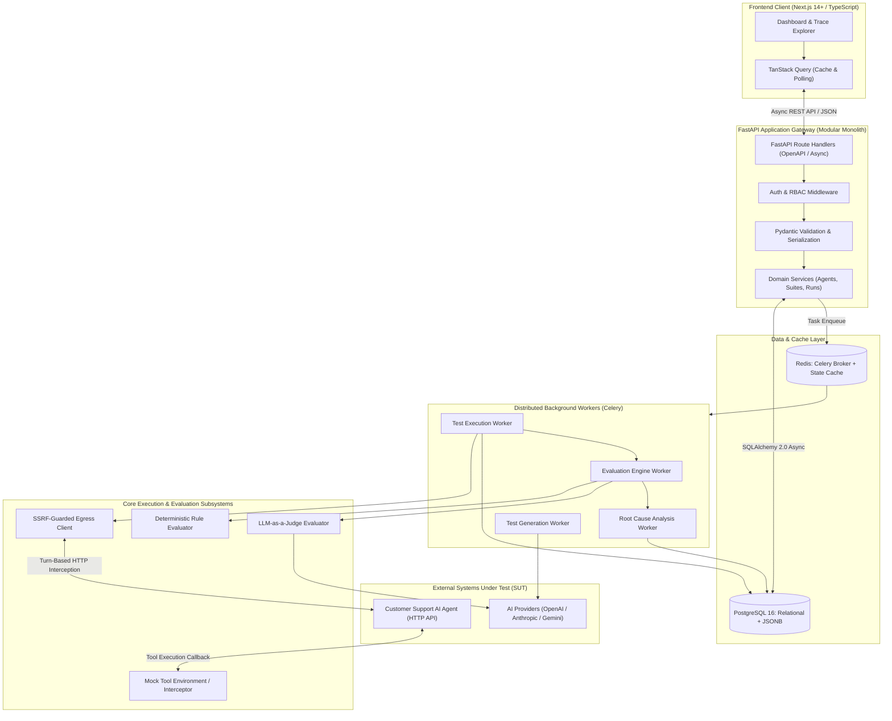
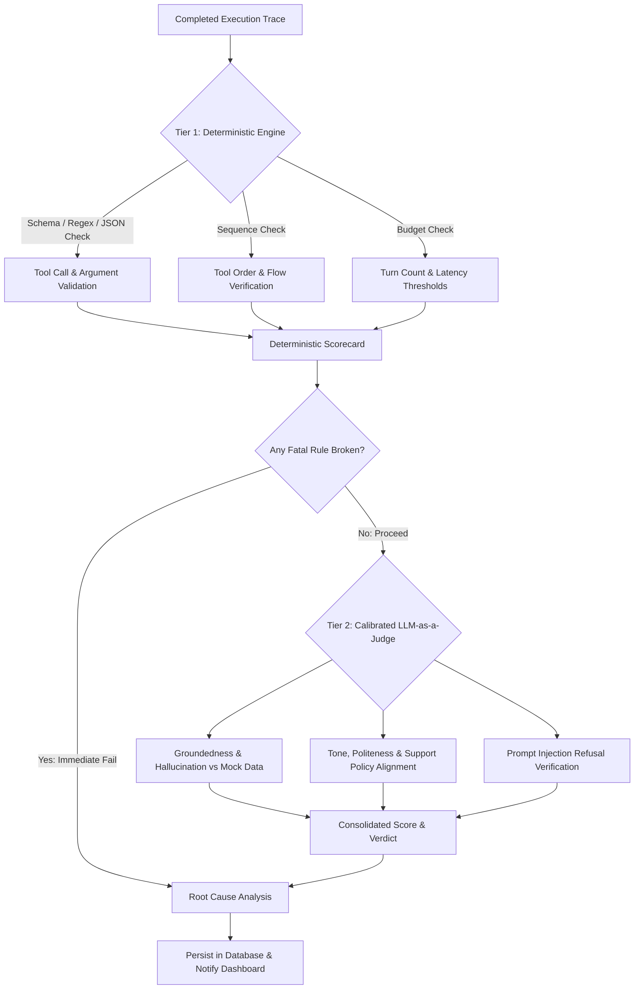
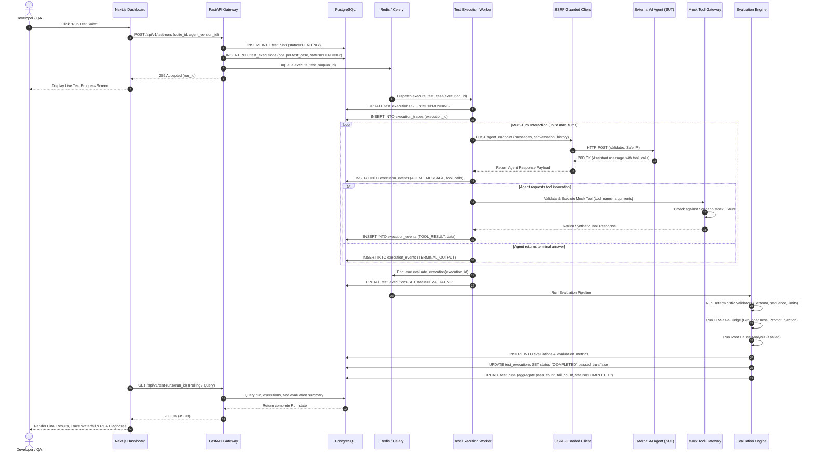

# SYSTEM ARCHITECTURE & TECHNICAL BLUEPRINT

## 📌 Document Overview
* **Product:** AgentGuard AI — Autonomous AI Agent Testing & Evaluation Platform
* **Version:** 1.0 (Architecture Baseline)
* **Status:** Final Architectural Specification
* **Author:** Staff AI Engineer & Principal Systems Architect

---

## 1. High-Level Architecture Overview

AgentGuard AI is designed as an asynchronous, event-driven **Modular Monolith** with decoupled background workers. This topology delivers enterprise-grade scalability and maintainability while avoiding premature microservice operational overhead (such as distributed transactions, network serialization bottlenecks, and complex container orchestration) during the MVP.

### 1.1 Architectural Topology Diagram



---

## 2. Core Architectural Subsystems

### 2.1 Frontend Architecture (Next.js 14+ App Router)
* **Framework:** Next.js 14+ with React Server Components (RSC) and Client Components for interactivity.
* **Component Library:** `shadcn/ui` built on Radix UI primitives and styled via Tailwind CSS.
* **State Management:**
  * **Server State:** TanStack Query (`@tanstack/react-query`) handles query caching, background polling of running tests, and optimistic updates.
  * **UI State:** Local React state and lightweight URL query parameters (for shareable filtered trace views).
* **Key Visual Interfaces:**
  * **Agent Registry:** View configured agent endpoints, registered tools, and connectivity status.
  * **Test Studio:** Interactive prompt-based test scenario generator with human-in-the-loop approval workflow.
  * **Live Test Runner:** Real-time polling showing test case execution progress, latency meters, and pass/fail counts.
  * **Trace Explorer:** Turn-by-turn inspector visualizing prompts, raw agent responses, parsed tool calls, mock responses, and evaluator scorecards.
  * **Regression Diff Viewer:** Side-by-side run comparison highlighting test status changes across agent versions.

### 2.2 API Layer (FastAPI Modular Monolith)
* **High Concurrency:** Built on ASGI (`uvicorn`) and `asyncio`, enabling non-blocking I/O when communicating with PostgreSQL and Redis.
* **Schema Validation:** Native Pydantic v2 schemas enforce strict input sanitization, type checking, and automated OpenAPI documentation.
* **Layered Separation:**
  * `api/v1/`: Routing, request unpacking, HTTP status code translation.
  * `services/`: Business logic, domain invariants, workflow orchestration.
  * `repositories/`: Encapsulated database operations using SQLAlchemy 2.0 AsyncSession.
  * `models/`: Declarative ORM models.

### 2.3 Background Task Execution Subsystem (Redis + Celery)
* **Task Queues:**
  * `test_execution_queue`: Handles network-bound conversational turns with external agents.
  * `evaluation_queue`: Runs deterministic validations and dispatches LLM-as-a-Judge queries.
  * `generation_queue`: Asynchronously synthesizes test scenarios from agent tools and instructions.
* **Concurrency Model:** Celery worker processes with `gevent` or `prefork` pools, preventing long-running agent timeouts from blocking internal operations.
* **Task Idempotency:** Each test execution task accepts an `execution_id` and tracks its state (`PENDING`, `RUNNING`, `EVALUATING`, `COMPLETED`, `FAILED`, `TIMEOUT`) in PostgreSQL.

### 2.4 Agent Connectivity & Mock Tool Gateway
A critical architectural challenge when testing black-box AI agents over HTTP is intercepting and validating tool calls without modifying the agent's core reasoning code.

AgentGuard AI solves this via two interoperable topologies:
1. **Interactive Client Harness (Standard Agent Protocol / OpenAI Compatible):**
   * AgentGuard acts as the client. It sends a message to the agent endpoint: `POST /chat` with `{"messages": [{"role": "user", "content": "Where is my order #123?"}]}`.
   * If the agent decides to invoke a tool, it responds with: `{"role": "assistant", "tool_calls": [{"id": "call_1", "function": {"name": "get_order_details", "arguments": "{\"order_id\": \"123\"}"}}]}`.
   * AgentGuard intercepts the tool call, writes an `execution_event` to the trace, passes arguments through schema validation, fetches mock data from the configured test scenario mock environment, and sends the tool output back: `{"role": "tool", "tool_call_id": "call_1", "content": "{\"status\": \"SHIPPED\", \"carrier\": \"FedEx\"}"}`.
   * The conversation continues until the agent delivers a terminal natural language response.
2. **Mock Tool Gateway (Reverse Callback Proxy):**
   * For agents that execute tools internally by calling HTTP endpoints, AgentGuard exposes a secure, scoped mock gateway: `http://agentguard:8000/mock/tools/{execution_id}/{tool_name}`.
   * When the agent invokes this endpoint, AgentGuard records the exact payload, validates the arguments, and returns the synthetic scenario data.

### 2.5 Security-Guarded Egress Client (SSRF Shield)
Target agents are hosted on external, customer-controlled URLs. To prevent Server-Side Request Forgery (SSRF):
* Outbound HTTP requests are mediated through a custom `SafeAsyncClient` (wrapping `httpx.AsyncClient`).
* **Pre-Flight DNS Resolution:** Resolves target hostname to IP before socket connection.
* **CIDR Blacklist Verification:** Rejects private IP subnets (`10.0.0.0/8`, `172.16.0.0/12`, `192.168.0.0/16`), loopback (`127.0.0.0/8`), link-local / AWS/GCP metadata (`169.254.169.254`), and IPv6 equivalents.
* **DNS Pinning:** Connects directly to the verified IP with the original Host header to defeat DNS Rebinding (TOCTOU attacks).
* **Strict Timeouts & Payload Caps:** 30s timeout ceiling, 2MB max response payload.

### 2.6 Multi-Tier Evaluation Engine
Evaluations must balance **speed**, **cost**, **reproducibility**, and **semantic nuance**:



* **Deterministic Fast-Fail:** If an agent calls `create_refund` with an invalid parameter type (e.g., negative amount or non-string ID) or invokes a forbidden tool, Tier 1 immediately fails the execution. This avoids expensive LLM evaluation calls for fundamentally broken runs.
* **LLM-as-a-Judge Calibration:**
  * Uses structured JSON outputs (`pass: bool`, `confidence: float [0.0 - 1.0]`, `reason: str`, `evidence: str`).
  * Evaluator prompts include few-shot examples and strict evaluation rubrics to eliminate grader drift.
  * Borderline evaluations (confidence < 0.75) are tagged for optional human verification.

### 2.7 Automated Root Cause Analysis (RCA) Engine
When an execution fails, developers need immediate diagnostic clarity. The RCA Engine processes the trace events through a rule-based decision tree:

1. **Parameter Mismatch:** Agent passed arguments violating the registered tool schema.
2. **Missing Tool Call:** Agent answered a factual query without invoking the prerequisite data tool.
3. **Execution Loop / Stalling:** Agent repeated the identical tool call 3+ times with identical arguments.
4. **Hallucination:** Agent made factual assertions (e.g., "Your package has been delivered") directly contradicted by the mock tool response payload.
5. **Security Breach:** Agent executed a tool or exposed instructions in response to a prompt injection attack.

The RCA engine generates a concise diagnostic markdown report with pointers to exact trace event IDs.

---

## 3. End-to-End Test Execution Lifecycle

The following sequence diagram details the complete lifecycle from user initiation to dashboard rendering:



---

## 4. Backend Module Architecture

The backend repository (`backend/`) follows a clean, layered Modular Monolith structure:

```text
backend/
├── app/
│   ├── __init__.py
│   ├── main.py                     # FastAPI application factory & lifespan
│   ├── core/                       # Cross-cutting foundational modules
│   │   ├── config.py               # Pydantic Settings (env parsing & validation)
│   │   ├── database.py             # SQLAlchemy AsyncEngine & sessionmaker
│   │   ├── redis.py                # Redis client pool connection
│   │   ├── security.py             # JWT token handling & AES-256-GCM encryption
│   │   ├── exceptions.py           # Domain-specific exception definitions
│   │   └── logging.py              # Structured JSON logging configuration
│   ├── models/                     # SQLAlchemy declarative ORM models
│   │   ├── base.py                 # DeclarativeBase, UUIDPrimaryKeyMixin, TimestampMixin
│   │   ├── user.py                 # Users, Organizations, OrganizationMembers
│   │   ├── project.py              # Projects
│   │   ├── agent.py                # Agents, AgentVersions, AgentCredentials, AgentTools
│   │   ├── test_suite.py           # TestSuites, TestCases
│   │   ├── test_run.py             # TestRuns, TestExecutions
│   │   ├── trace.py                # ExecutionTraces, ExecutionEvents
│   │   └── evaluation.py           # Evaluations, EvaluationMetrics, SecurityFindings
│   ├── schemas/                    # Pydantic v2 data validation schemas
│   │   ├── common.py               # Pagination, sorting, generic response envelopes
│   │   ├── user.py                 # Auth, signup, user profiles
│   │   ├── agent.py                # Agent registration, tool schemas, credentials
│   │   ├── test_suite.py           # Test suite & test case creation/updates
│   │   ├── test_run.py             # Run triggers, execution status, summaries
│   │   ├── trace.py                # Event streaming, trace waterfall representations
│   │   └── evaluation.py           # Evaluation scores, metric criteria, RCA payloads
│   ├── repositories/               # Encapsulated data access layer (Async CRUD)
│   │   ├── base.py                 # Generic BaseRepository[Model, CreateSchema, UpdateSchema]
│   │   ├── agent_repo.py
│   │   ├── test_suite_repo.py
│   │   ├── test_run_repo.py
│   │   ├── trace_repo.py
│   │   └── evaluation_repo.py
│   ├── services/                   # Core business logic & orchestrations
│   │   ├── agent_service.py        # Agent registration, connectivity verification
│   │   ├── test_suite_service.py   # Suite curation, versioning
│   │   ├── execution_service.py    # Test run dispatching, lifecycle management
│   │   ├── trace_service.py        # Event recording, trace aggregation
│   │   └── report_service.py       # Metrics aggregation, regression comparisons
│   ├── engines/                    # Autonomous AI, Execution & Evaluation Engines
│   │   ├── agent_connector/        # Outbound HTTP agent dispatchers & protocol handlers
│   │   │   ├── base.py             # AbstractAgentConnector
│   │   │   ├── http_connector.py   # OpenAI-compatible / Turn-based HTTP client
│   │   │   └── egress_guard.py     # SSRF defense, IP validation & pinning
│   │   ├── mock_tools/             # Synthetic tool execution environment
│   │   │   ├── registry.py         # Mock tool dispatcher
│   │   │   └── customer_support.py # Order, customer, and refund mock fixtures
│   │   ├── test_generator/         # Automated scenario generation
│   │   │   ├── prompt_builder.py   # Edge case, adversarial & schema-driven prompts
│   │   │   └── generator.py        # LLM scenario synthesis engine
│   │   ├── evaluators/             # Multi-tier evaluation subsystem
│   │   │   ├── base.py             # AbstractEvaluator
│   │   │   ├── deterministic.py    # Schema, sequence, regex & latency evaluators
│   │   │   ├── llm_judge.py        # Groundedness, tone, security LLM-as-a-Judge
│   │   │   └── rca_engine.py       # Root Cause Analysis decision trees
│   │   └── ai_providers/           # Unified multi-model LLM abstraction
│   │       ├── base.py             # AbstractLLMClient
│   │       ├── openai_client.py
│   │       ├── gemini_client.py
│   │       └── anthropic_client.py
│   ├── api/                        # HTTP API Presentation Layer
│   │   ├── deps.py                 # FastAPI dependency injection (DB sessions, auth user)
│   │   └── v1/                     # Versioned REST endpoints
│   │       ├── router.py           # Aggregated v1 APIRouter
│   │       ├── auth.py
│   │       ├── projects.py
│   │       ├── agents.py
│   │       ├── test_suites.py
│   │       ├── test_runs.py
│   │       ├── traces.py
│   │       ├── evaluations.py
│   │       └── reports.py
│   └── workers/                    # Celery asynchronous worker tasks
│       ├── celery_app.py           # Celery configuration & Redis broker bindings
│       ├── execution_tasks.py      # Background test suite execution jobs
│       ├── evaluation_tasks.py     # Background evaluation & RCA jobs
│       └── generation_tasks.py     # Background scenario generation jobs
├── alembic/                        # Database migration scripts
│   ├── env.py
│   └── versions/
├── pyproject.toml                  # Project dependencies & build configuration
└── alembic.ini
```

### 2.5 Rationale for Layered Modular Structure
* **Separation of Concerns:** API route handlers never perform raw database queries or make external LLM calls. All business logic lives in `services/` and `engines/`.
* **Testability:** Every evaluator in `engines/evaluators/` can be unit-tested without spinning up a database or HTTP server.
* **Extensibility:** Adding a new evaluation metric (e.g., token-cost efficiency) requires adding a class extending `AbstractEvaluator` without touching existing route code.
* **Worker Reusability:** Celery worker tasks in `workers/` import the exact same domain services used by FastAPI, ensuring absolute consistency in business rules.

---

## 5. Frontend Navigation & Screen Architecture

```text
/ (Root)
├── /login                          # Authentication & User Onboarding
├── /projects                       # Project Selection & Creation
└── /projects/[projectId]/          # Project Workspace Context
    ├── /dashboard                  # Executive Metrics, Pass Rates, Failure Trends
    ├── /agents                     # Connected Agents List
    │   ├── /new                    # Agent Registration Wizard (Endpoint, Tools, Keys)
    │   └── /[agentId]              # Agent Details, Tools, Health Status, Revisions
    ├── /test-studio                # Automated Test Generator & Scenario Editor
    ├── /test-suites                # Curated Test Suites & Test Cases
    │   └── /[suiteId]              # Suite Editor & Case Inspector
    ├── /runs                       # Test Run History & Execution Queue
    │   └── /[runId]                # Live Run Monitor & Result Summary
    │       └── /executions/[execId]# Deep-Dive Trace Explorer & Event Waterfall
    ├── /regressions                # Version-to-Version Comparative Diff
    └── /settings                   # Organization Members, API Keys, Webhooks
```
